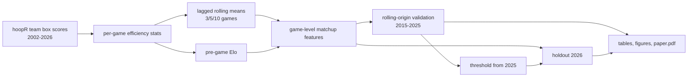

# Leakage-Aware NBA Win Modeling

[](https://github.com/kalebcoleman/nba-modeling/actions/workflows/tests.yaml)

Predicting whether the home team wins an NBA regular-season game using only
information available before tip-off: lagged rolling means of team box-score
efficiency and pre-game Elo ratings. Predictions for the current season are
logged every day before tip-off.

- Paper: [`paper/paper.pdf`](paper/paper.pdf)
- Site, with live 2026-27 results: <https://kalebcoleman.github.io/nba-modeling/>
- Data package: [nba-data](https://github.com/kalebcoleman/nba-data)

## Results

Models were trained on 2001-02 through 2024-25 and tested once on the
2025-26 season (1,215 games), which no earlier version of this project used.

| Model | Accuracy | AUC | Brier |
|---|---:|---:|---:|
| Always pick the home team | 0.554 | – | 0.248 |
| Logistic, Elo only | 0.679 | 0.731 | 0.208 |
| Logistic, 5-game rolling differences | 0.642 | 0.683 | 0.223 |
| Ridge, rolling features only | 0.664 | 0.712 | 0.214 |
| **Ridge, rolling features + Elo** | **0.686** | **0.738** | **0.205** |
| Elastic net, rolling features + Elo | 0.686 | 0.737 | 0.205 |
| Gradient boosting (xgboost), rolling + Elo | 0.682 | 0.733 | 0.207 |
| Neural net (one hidden layer), rolling + Elo | 0.653 | 0.709 | 0.222 |

- The 95% bootstrap interval for accuracy of the best model is 0.662–0.712.
- Elo alone gets most of the way there. The paired bootstrap interval for the
  AUC gain from adding rolling features to Elo is −0.002 to 0.015, which
  includes zero.
- Untuned gradient boosting and a small neural net did not beat the linear
  models.
- The same pattern holds across 11 validation seasons (2015–2025), each
  predicted by a model trained on all earlier seasons:


## How leakage is prevented

- **Features.** The rolling value for a team's game *t* is the mean of its
  games *t−w* to *t−1* in the same season (*w* = 3, 5, 10). Elo ratings are
  recorded before each game's result is applied.
- **Tested, not just claimed.** [`tests/testthat/test-features.R`](tests/testthat/test-features.R)
  changes the result of one mid-season game and checks that no feature for that
  game or any earlier game changes.
- **Evaluation.** Rolling-origin validation by season. The classification
  threshold is chosen on the last validation season, not the test season.
  Penalty tuning uses folds of whole seasons.

## Live season

[`scripts/live_update.R`](scripts/live_update.R) runs every morning in GitHub
Actions ([`.github/workflows/live.yaml`](.github/workflows/live.yaml)):

1. `NBAData::nba_update()` collects new games and the schedule from ESPN.
2. Every model is fitted on 2002–2026 with a fixed seed, so the models stay the
   same all season.
3. A home-win probability for each of today's games is appended to
   [`live/predictions_2027.csv`](live/predictions_2027.csv) before tip-off.
4. Finished games are scored, and the site is rebuilt.

A team's first game of the season has no rolling history; those games use the
Elo-only model and are flagged. Because the 2025-26 holdout has now been
looked at, the live season is the only untouched test.

## Pipeline



The pipeline is defined in [`_targets.R`](_targets.R); the functions live in
[`R/`](R).

### Adding a model

Write a function in [`R/model_registry.R`](R/model_registry.R) that returns a
name, a feature set, and a fit function (any parsnip spec works through
`fit_parsnip()`), and add its id to `MODEL_IDS`. `targets::tar_make()` then fits
only the new model; it shows up in every table and figure, and the live job
starts logging it. See the [Methods page](https://kalebcoleman.github.io/nba-modeling/methods.html)
for an example.

## Reproduce

Requirements: R 4.6, a LaTeX distribution with biber (for the PDF), and on
Ubuntu `libcurl4-openssl-dev libssl-dev libxml2-dev libglpk-dev`.

```r
renv::restore()        # install pinned package versions
targets::tar_make()    # features, models, tables, figures, site, and paper/paper.pdf
```

The full run takes a few minutes. Data comes from
`hoopR::load_nba_team_box()` (ESPN box scores compiled by SportsDataverse). If
`data/team_box_raw.rds` exists, the pipeline uses it; otherwise it downloads
the data. The results above use a pull from October 28, 2026.

Run the tests and linter:

```sh
Rscript tests/testthat.R
Rscript -e 'lintr::lint_dir(".")'
```

## Limitations

- One test season. Accuracy on a single season has a 95% interval about five
  percentage points wide.
- No rest, travel, injury, or roster data.
- Home-court advantage has declined over time, and models trained on all past
  seasons over-predict home wins in 2025-26.
- Elo settings, gradient boosting, and the neural net were not tuned.

## Course version

This started as a final project for STA 478 (January 2026). The original paper
and its R Markdown source are in [`reports/`](reports), with the proposal and
slides in [`proposal/`](proposal) and [`presentation/`](presentation). Its code
is at commit `27cb871`.

Rerunning that code reproduces its numbers, but the revision fixes several
problems. Its cross-validation mixed future and past seasons, and its
"tuned threshold" accuracy (0.670) was tuned on the test season. Its data pull
was missing 113 games from 2024-25. Its text also understated the role of Elo
and misdescribed the inferential model. The paper's "Changes from the course version"
section lists each one.

## License

Code is MIT licensed (see [`LICENSE`](LICENSE)). See
[`CITATION.cff`](CITATION.cff) to cite this work.
