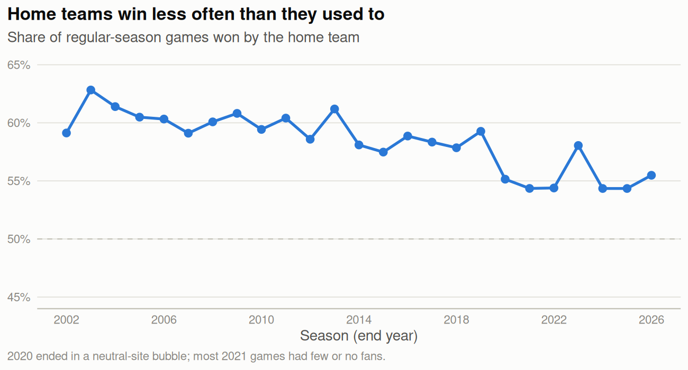
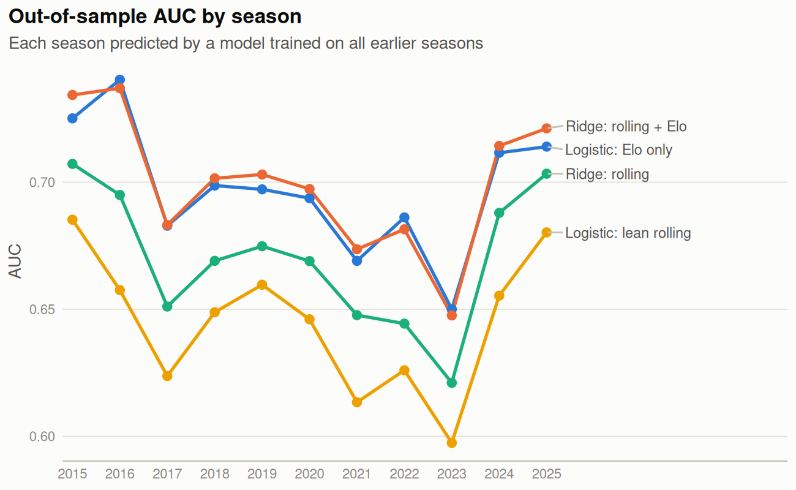
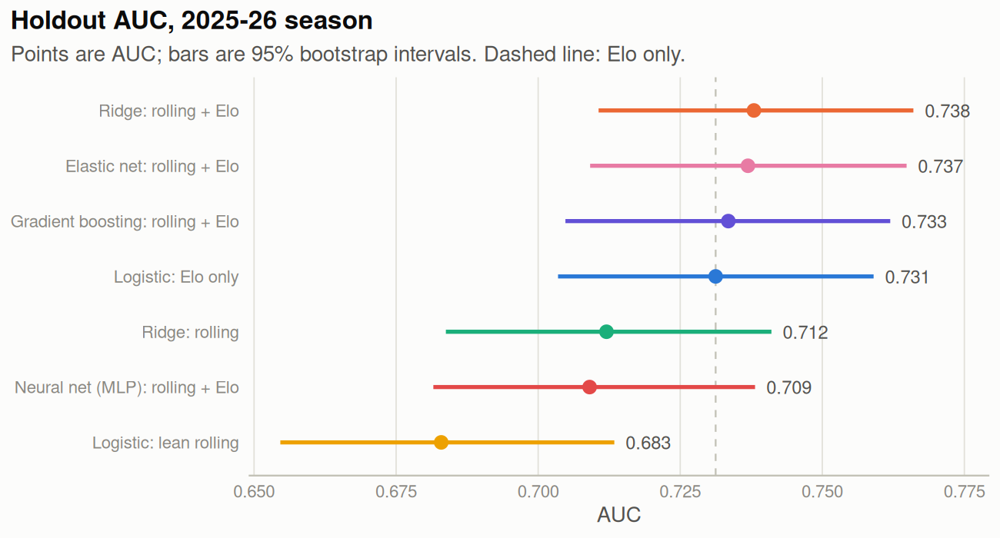
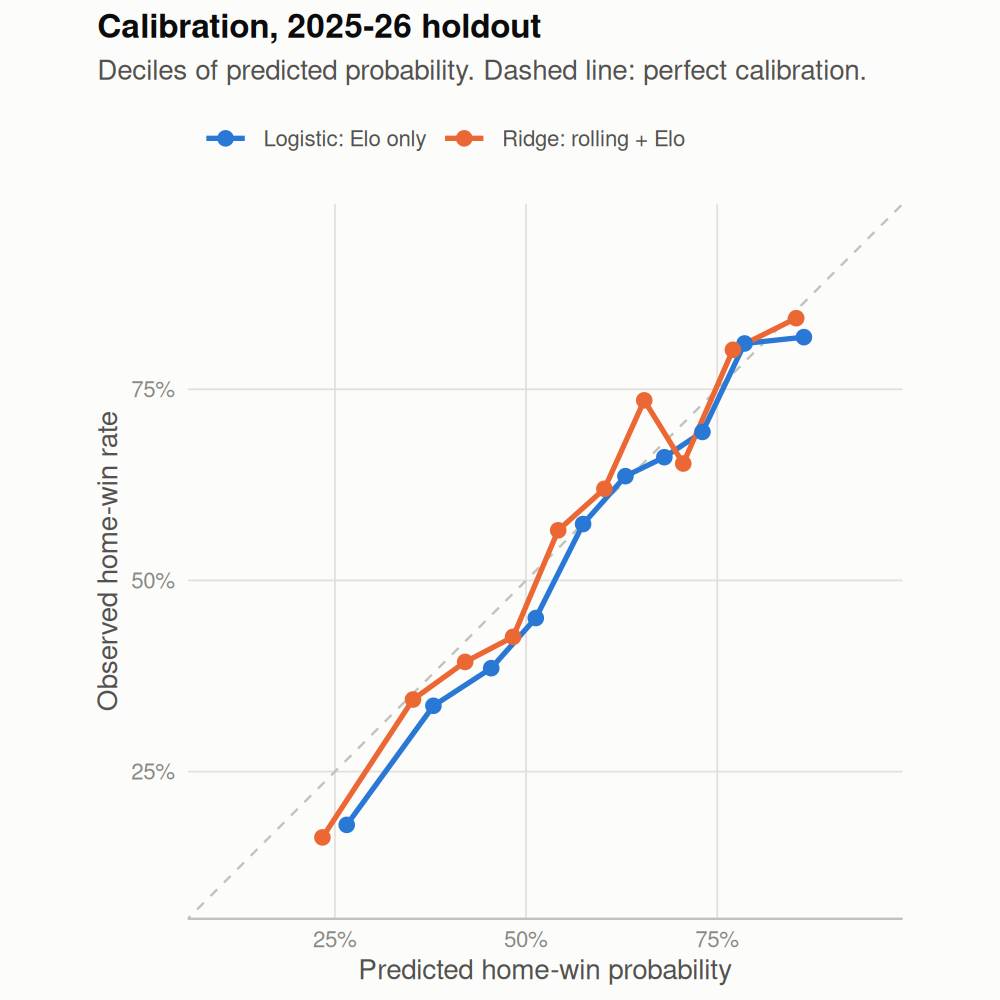

```{r setup}
# Loaded by setup.R from the YAML header; listed here so targets tracks them.
tar_load(c(
  coverage, validation_summary, validation_by_season, holdout_metrics,
  holdout_bootstrap, odds_lean, odds_lean_elo, frame
))
invisible(tar_read(fig_validation))
invisible(tar_read(fig_calibration))
invisible(tar_read(fig_model_comparison))
invisible(tar_read(fig_home_advantage))
```

# Introduction

Box-score statistics from a game describe that game. Using them to predict the
same game's result is leakage: the model sees information that would not exist
at prediction time, and its accuracy looks better than it is
[@kaufman2012leakage]. The same problem appears in evaluation when a model is
validated on games that happened before the games it was trained on.

This project builds pre-game features from team box scores, checks in code that
no feature uses the game it describes or any later game, and evaluates models
in time order. It asks two questions:

1. How much better than "the home team wins" can pre-game rolling efficiency
   metrics predict single-game outcomes?
2. Do those metrics add anything beyond a simple Elo rating [@elo1978rating]?

# Data

Team box scores come from `hoopR::load_nba_team_box()` [@gilani2021hoopr],
which serves ESPN box scores compiled by the SportsDataverse project. I keep
regular-season games between the 30 current franchises for the 2001--02
through 2025--26 seasons (labeled 2002--2026 by season end year). The snapshot
used here was pulled on October 28, 2026.

```{r coverage}
#| tbl-cap: "Games per season in the modeling data. 2002--2004 had 29 teams (1,189 games); 2012 (lockout), 2020, and 2021 were shortened."
cov <- coverage |>
  mutate(Season = as.character(season), Games = format(games, big.mark = ","))
half <- ceiling(nrow(cov) / 2)
knitr::kable(
  cbind(cov[1:half, c("Season", "Games")], rbind(cov[(half + 1):nrow(cov), c("Season", "Games")], data.frame(Season = "", Games = ""))),
  col.names = c("Season", "Games", "Season", "Games"),
  booktabs = TRUE, align = "lrlr"
)
```

After dropping each team's first game of every season (where no rolling
history exists), `r format(nrow(frame), big.mark = ",")` games remain. The home
team won `r pct(home_rate_train)` of games from 2002 to 2025, but that share
has fallen over time (@fig-home), which matters for any model trained on all
past seasons.

{#fig-home width=90%}

# Features

**Per-game efficiency.** For each team and game I compute possessions and the
standard rate statistics [@oliver2004basketball; @kubatko2007starting]:
effective field-goal percentage, true shooting percentage, free-throw rate,
three-point attempt rate, offensive and defensive rating, net rating,
offensive and defensive rebound percentage, and turnover percentage.

**Lagged rolling means.** For a window of $w \in \{3, 5, 10\}$ games, the
feature for a team's game $t$ is the mean of that statistic over the team's
games $t-w$ to $t-1$ in the same season. The current game is never included,
and windows reset at the start of each season, so the first game of a season
has no value.

**Matchup features.** Each game gets the home and away team's rolling values,
plus home-minus-away differences and home/away ratios for rebounding and
turnover rates.

**Elo.** Ratings start at 1500, use $K = 20$ and a 100-point home advantage,
and are updated after each game. The value attached to a game is the rating
*before* that game. I keep two versions: one reset every season and one
carried across seasons.

**Checks.** The test suite (`tests/testthat/test-features.R`) confirms that
each rolling value equals the mean of the previous $w$ games and that first
games have no value. It also changes the result of one mid-season game and
checks that no feature for that game, or any earlier game, changes, while
later games do change.

# Evaluation design

All evaluation is in time order [@hyndman2021fpp3].

- **Validation (2015--2025).** For each season $s$, models are trained on all
  seasons before $s$ and predict $s$. This gives 11 out-of-sample seasons.
- **Threshold.** The cutoff for calling a home win is chosen to maximize
  accuracy on the last validation season (2025), then applied unchanged to the
  holdout.
- **Holdout (2026).** Models trained on 2002--2025 predict the
  2025--26 season once (`r format(holdout_n, big.mark = ",")` games).
- **Penalty tuning.** For ridge and elastic net [@friedman2010glmnet], the
  penalty is chosen by cross-validation inside the training seasons, with
  folds made of whole seasons.
- **Metrics.** Accuracy, AUC [@robin2011proc], Brier score
  [@brier1950verification], and log loss. Holdout intervals come from 2,000
  bootstrap resamples of games [@efron1993bootstrap], including a paired
  interval for each model's AUC minus the Elo-only model's AUC.

The models are:

- **Majority:** always predict the training-set home-win rate.
- **Logistic, Elo only:** season-reset and all-time Elo differences.
- **Logistic, lean rolling:** five-game differences in net rating,
  offensive-minus-defensive rating, offensive rebound percentage, turnover
  percentage, and effective field-goal percentage.
- **Ridge, rolling:** all rolling features (3, 5, and 10 games), no Elo.
- **Ridge, rolling + Elo**, and **elastic net, rolling + Elo**
  ($\alpha \in \{0.25, 0.5, 0.75\}$).
- **Gradient boosting** (xgboost; 400 trees of depth 3, learning rate 0.03)
  and a **neural net** (one hidden layer of 8 units, weight decay 0.1, inputs
  standardized), both on rolling features + Elo. Their settings are fixed
  defaults, not tuned, so they are a check on whether a nonlinear model finds
  structure the linear models miss rather than a tuned comparison.

# Results

## Validation seasons

```{r validation-table}
#| tbl-cap: "Mean out-of-sample metrics over the 2015--2025 validation seasons (each season predicted by a model trained on all earlier seasons). Threshold 0.5."
validation_summary |>
  mutate(model = factor(model, model_order)) |>
  arrange(model) |>
  transmute(Model = model, Accuracy = f3(accuracy), AUC = ifelse(is.na(auc), "--", f3(auc)),
            Brier = f3(brier), `Log loss` = f3(log_loss)) |>
  knitr::kable(booktabs = TRUE, align = "lrrrr")
```

Across the validation seasons, ridge with rolling features and Elo averaged an
AUC of `r f3(v("Ridge: rolling + Elo")$auc)`. The Elo-only logistic model
averaged `r f3(v("Logistic: Elo only")$auc)`, and rolling features without Elo
averaged `r f3(v("Ridge: rolling")$auc)`. Season by season
(@fig-validation), the full model had a higher AUC than Elo only in
`r n_full_beats_elo` of `r n_val` seasons, and Elo only beat the rolling
features without Elo in `r n_elo_beats_roll` of `r n_val`.

{#fig-validation width=95%}

## Holdout season (2025--26)

```{r holdout-table}
#| tbl-cap: "Holdout results for the 2025--26 season. Accuracy is shown at 0.5 and at the threshold chosen on the 2025 validation season. Intervals are 95% bootstrap percentile intervals."
holdout_metrics |>
  left_join(holdout_bootstrap, by = "model") |>
  mutate(model = factor(model, model_order)) |>
  arrange(model) |>
  transmute(
    Model = model,
    `Acc. (0.5)` = f3(accuracy),
    `95% CI` = sprintf("%s--%s", f3(accuracy_low), f3(accuracy_high)),
    `Acc. (val. thr.)` = sprintf("%s (%.2f)", f3(accuracy_at_validation_threshold), threshold_from_validation),
    AUC = ifelse(is.na(auc), "--", f3(auc)),
    `AUC 95% CI` = ifelse(is.na(auc), "--", sprintf("%s--%s", f3(auc_low), f3(auc_high))),
    Brier = f3(brier)
  ) |>
  knitr::kable(booktabs = TRUE, align = "lrrrrrr")
```

{#fig-models width=95%}

On the holdout (@fig-models), ridge with rolling features and Elo predicted
`r pct(h("Ridge: rolling + Elo")$accuracy)` of games correctly (AUC
`r f3(h("Ridge: rolling + Elo")$auc)`), compared with
`r pct(h("Majority (home win rate)")$accuracy)` for always picking the home
team. The Elo-only model reached `r pct(h("Logistic: Elo only")$accuracy)`
(AUC `r f3(h("Logistic: Elo only")$auc)`).

The paired bootstrap interval for the AUC gain of ridge with rolling features
and Elo over Elo only is
`r f3(b("Ridge: rolling + Elo")$auc_diff_vs_ref_low)` to
`r f3(b("Ridge: rolling + Elo")$auc_diff_vs_ref_high)`, which includes zero.
For elastic net it is `r f3(b("Elastic net: rolling + Elo")$auc_diff_vs_ref_low)`
to `r f3(b("Elastic net: rolling + Elo")$auc_diff_vs_ref_high)`. Rolling
features may add a small amount of discrimination, but this season cannot
distinguish that from no gain.

The two nonlinear models did not improve on the linear ones. Gradient
boosting reached an AUC of `r f3(h("Gradient boosting: rolling + Elo")$auc)`
on the holdout, close to Elo only, and the untuned neural net reached
`r f3(h("Neural net (MLP): rolling + Elo")$auc)`, below Elo only (paired
interval `r f3(b("Neural net (MLP): rolling + Elo")$auc_diff_vs_ref_low)` to
`r f3(b("Neural net (MLP): rolling + Elo")$auc_diff_vs_ref_high)`). With
`r n_features` mostly correlated features and noisy outcomes, there may be
little nonlinear structure to find, and the untuned neural net may overfit.
Tuning both would need nested time-ordered validation, which I did not do.

Choosing the threshold on 2025 instead of using 0.5 changed holdout accuracy
by at most `r sprintf("%.1f", 100 * max(abs(holdout_metrics$accuracy - holdout_metrics$accuracy_at_validation_threshold)))`
percentage points for any model.

{#fig-calibration width=60%}

Both models over-predict home wins in the lower deciles of predicted
probability (@fig-calibration). This fits a lower home-win rate in 2025--26
(`r pct(mean(frame$home_win[frame$season == 2026]))`) than in the training
seasons (`r pct(home_rate_train)`). Each decile holds about 120 games, so
single bins are noisy.

## Odds ratios

To describe associations rather than predict, I fit the lean logistic model on
2002--2025, with and without Elo. Rate differences are scaled so that odds
ratios are per percentage point.

```{r odds-table}
#| tbl-cap: "Odds ratios for a one-unit increase in each home-minus-away difference, fit on 2002--2025. Left: lean rolling model. Right: same model with Elo."
lab <- c(
  matchup_net_roll5 = "Net rating, 5 games",
  matchup_ortg_drtg_roll5 = "Home ORtg - away DRtg, 5 games",
  orb_roll5_diff = "Off. rebound %, 5 games",
  tov_roll5_diff = "Turnover %, 5 games",
  efg_roll5_diff = "eFG%, 5 games",
  Elo_Diff_season = "Elo, season reset",
  Elo_Diff_alltime = "Elo, all time"
)
fmt_or <- function(d) {
  transmute(d, term, or = sprintf("%.4f [%.4f, %.4f]", odds_ratio, ci_low, ci_high),
            p = ifelse(p_value < 0.001, "<0.001", sprintf("%.3f", p_value)))
}
full_join(fmt_or(odds_lean), fmt_or(odds_lean_elo), by = "term", suffix = c("_lean", "_elo")) |>
  mutate(term = lab[term]) |>
  mutate(across(everything(), ~ ifelse(is.na(.x), "--", .x))) |>
  knitr::kable(col.names = c("Term", "OR [95% CI]", "p", "OR [95% CI]", "p"), booktabs = TRUE, align = "lrrrr")
```

Without Elo, a one-point advantage in five-game net rating is associated with
`r sprintf("%.1f%%", 100 * (odds_lean$odds_ratio[odds_lean$term == "matchup_net_roll5"] - 1))`
higher odds of a home win. Holding net rating fixed, higher offensive rebound
and turnover percentages are associated with slightly *lower* odds. This is
expected rather than meaningful: net rating already reflects rebounding and
turnovers, so these terms describe how a given net rating was produced, not
separate effects. The effective field-goal term is not distinguishable from
zero. Once Elo is added, the rate terms are all indistinguishable from zero,
net rating's odds ratio shrinks to
`r sprintf("%.4f", odds_lean_elo$odds_ratio[odds_lean_elo$term == "matchup_net_roll5"])`,
and both Elo terms remain strongly associated with winning.

# Changes from the course version

The original paper (January 2026, kept in `reports/`) was written for a
course. Rerunning its code on its own data snapshot reproduces its numbers. I
found the following problems, which this version corrects.

```{r changes}
#| tbl-cap: "Course-version claims and what the code and corrected analysis show. Course numbers come from rerunning the original code on the January 2026 snapshot (2025 test season)."
tibble::tibble(
  Issue = c(
    "Cross-validation",
    "Tuned threshold",
    "Data completeness",
    "Elo",
    "Inferential model",
    "Data source"
  ),
  `Course version` = c(
    "Random 5-fold CV across 2002--2024; later seasons predicted earlier ones",
    "Threshold tuned on the 2025 test season; reported 0.670 accuracy",
    "Snapshot had 1,118 of 1,231 games in 2025 and 1,035 of 1,080 in 2021",
    "Described as not emphasized, but included in every penalized model and the inferential model",
    "Described as net rating, eFG%, and TOV%; text said shooting raised and turnovers lowered odds",
    "Cited as the NBA Stats API"
  ),
  `This version` = c(
    "Rolling-origin validation by season",
    "Threshold chosen on the 2025 validation season and applied to 2026; it changed accuracy by under one point",
    "Fresh pull with full seasons",
    "Elo reported as its own baseline; it carries most of the signal",
    "Five terms plus a version with Elo; eFG% and TOV% effects were not significant in the course model",
    "hoopR / SportsDataverse (ESPN box scores)"
  )
) |>
  knitr::kable(booktabs = TRUE) |>
  kableExtra::column_spec(2:3, width = "6cm")
```

The course paper's headline numbers were not badly off: its 2025 holdout
accuracy for ridge (0.662, AUC 0.714) is close to what the corrected method
gives on complete 2025 data (`r f3(vs("Ridge: rolling + Elo", 2025)$accuracy)`,
AUC `r f3(vs("Ridge: rolling + Elo", 2025)$auc)`). The problems were in what
the evaluation could support: the tuned-threshold result was not a test-set
result, and the conclusion that rolling efficiency metrics drive predictions
did not account for Elo.

# Limitations

- Only one holdout season. The 95% interval for single-season accuracy is
  about `r sprintf("%.0f", 100 * (b("Ridge: rolling + Elo")$accuracy_high - b("Ridge: rolling + Elo")$accuracy_low))`
  percentage points wide.
- Home-court advantage has drifted down over time. Models trained on all past
  seasons over-predict home wins in a season like 2025--26.
- No rest, travel, injury, or roster information. Rolling team averages lag
  behind trades and injuries.
- Elo settings ($K$, home advantage, reset rule) were not tuned.
- Data comes from a third-party package. A few early seasons are missing games
  relative to the official schedule (for example, 1,224 of 1,229 in 2013), and
  missing games shift rolling windows.
- Gradient boosting and the neural net use fixed settings and were not tuned.

# Live evaluation (2026--27)

The 2025--26 holdout has now been looked at, so it can no longer serve as an
untouched test for choosing among models. The 2026--27 season is used for
that instead. Each morning a scheduled job updates the season's data with the
companion package `NBAData`, fits every model above on 2002--2026 with a fixed
seed (so the models do not change during the season), and appends a
probability for each of that day's games to a log before tip-off. A team's
first game of the season has no rolling history, so those games use the
Elo-only model. Results are scored as games finish and shown on the project
site. They are not part of this paper's results.

# Reproducibility

The analysis is a `targets` pipeline [@landau2021targets] with packages pinned
by `renv`. From a fresh clone with R 4.6:

```
renv::restore()
targets::tar_make()
```

This rebuilds every table, figure, the project site, and this PDF (which
needs a LaTeX installation with biber) from the saved data snapshot.
Deleting the snapshot pulls fresh data through hoopR. The tests run with
`Rscript tests/testthat.R`.

# References {.unnumbered}

::: {#refs}
:::
